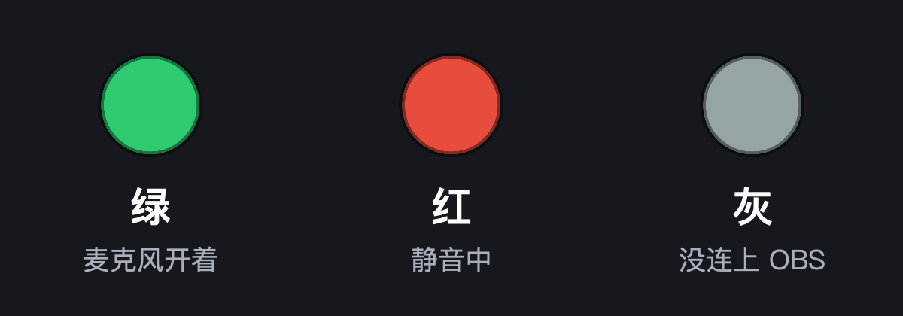
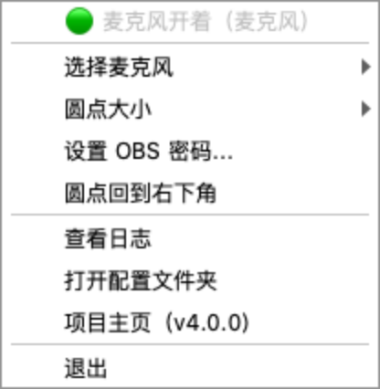

# OBS 麦克风指示灯

[English](README_EN.md)

屏幕角落一颗悬浮小圆点，**一眼看出 OBS 里的麦克风是开着还是静音**。打游戏、直播、录课时不用切回 OBS，再也不会"录了半小时，一个字没录上"。



- 🟢 **绿** = 麦克风开着　🔴 **红** = 静音　⚪ **灰** = 没连上 OBS（不会把"断线"误显示成"静音"）
- 不管你是按快捷键、点 OBS 里的喇叭、还是用 Stream Deck 静音，圆点都会**立刻**跟着变
- **Windows 和 Mac 都能用**，下载解压直接运行，不用装 Python
- 不用改任何配置文件：右键圆点就能选麦克风、填密码、调大小
- 圆点始终在最上层，能拖到任意位置，下次启动还在原地
- 免费开源（MIT），只连本机 OBS，不联网、不收集任何数据

---

## 3 步用起来（约 3 分钟）

### 第 1 步：在 OBS 里打开 WebSocket（只做一次）

OBS 28 及以上版本自带这个功能，不用装插件。

1. OBS 顶部菜单 **工具 → WebSocket 服务器设置**
2. 勾选 **启用 WebSocket 服务器**（端口保持 `4455`）
3. 点 **显示连接信息**，把 **服务器密码** 复制下来（第 3 步要粘贴）
4. 点 **确定**

> 菜单里找不到这一项 → OBS 太旧了，到 [obsproject.com](https://obsproject.com/) 升级。

### 第 2 步：下载并打开指示灯

到 **[Releases 下载页](https://github.com/wangchuanqiw/obs-mic-light/releases/latest)** 下载对应的压缩包：

| 你的电脑 | 下载这个 |
|---|---|
| Windows 10 / 11 | `OBS-Mic-Light-Windows.zip` |
| Mac（M1/M2/M3/M4/M5 芯片） | `OBS-Mic-Light-macOS-AppleSilicon.zip` |
| Mac（Intel 芯片） | `OBS-Mic-Light-macOS-Intel.zip` |

> 不知道 Mac 是什么芯片：左上角  → 关于本机，看"芯片"那一行。

<details>
<summary>🪟 <b>Windows</b>：解压后双击 <code>OBS Mic Light.exe</code></summary>

第一次打开如果弹出蓝色的 **"Windows 已保护你的电脑"**：点 **更多信息 → 仍要运行**。
（这是因为个人开源软件没有买微软的数字签名，不是病毒；不放心可以看源码自己运行，见下文。）

</details>

<details>
<summary>🍎 <b>Mac</b>：解压后把 <code>OBS Mic Light</code> 拖进"应用程序"，再双击打开</summary>

第一次打开会提示 **"无法验证开发者"** / **"Apple 无法检查其是否包含恶意软件"**：

1. 先点 **完成**（或"取消"）
2. 打开 **系统设置 → 隐私与安全性**，拉到最下面，点 **仍要打开**，输入开机密码

（同样是因为没有购买苹果开发者签名。只需要做一次。）

圆点出现后，菜单栏右上角也会多一个小圆点图标——Mac 版不在 Dock 里显示。

</details>

### 第 3 步：粘贴密码

程序第一次连 OBS 时会弹窗要密码，把第 1 步复制的密码粘贴进去，点 **OK**。

圆点从灰变成绿/红，就成功了。去 OBS 里点一下麦克风的静音按钮，圆点会立刻变色。

---

## 日常使用

| 操作 | 效果 |
|---|---|
| 左键按住圆点拖动 | 移动位置（会记住） |
| 右键圆点 / 点托盘（菜单栏）图标 | 打开菜单 |
| 鼠标悬停在圆点上 | 显示当前状态和监控的源 |



- **选择麦克风**：默认「自动」会找 OBS 里的麦克风；你有多个麦克风或改过名字，就在这里点选要监控的那一个
- **圆点大小**：小 / 中 / 大
- **设置 OBS 密码**：OBS 里换了密码时用
- **圆点回到右下角**：拖丢了 / 换了显示器时用
- **查看日志**：出问题时看这里

想开机自动启动：
- Windows：按 `Win + R` 输入 `shell:startup` 回车，把 `OBS Mic Light.exe` 的**快捷方式**放进去
- Mac：系统设置 → 通用 → 登录项 → 点 `+` 选 `OBS Mic Light`

---

## 常见问题

| 现象 | 怎么办 |
|---|---|
| 圆点一直是**灰色** | ① OBS 没打开；② 第 1 步的 WebSocket 没启用；③ 改完 WebSocket 设置后重启一下 OBS 试试 |
| 弹窗说**密码不对** | 回 OBS → 工具 → WebSocket 服务器设置 → 显示连接信息，重新复制密码。注意别多复制空格 |
| 圆点有颜色但**按静音不变** | 你按的和它监控的不是同一个源。鼠标悬停圆点看它在监控谁，右键 → 选择麦克风，换成你实际用的那个 |
| **全屏游戏里看不到圆点** | 游戏设置里把"全屏"改成"无边框窗口 / 无边框全屏"。独占全屏会盖住所有悬浮窗，这是系统限制 |
| 提示"已经在运行了" | 屏幕上已经有一颗圆点了（可能被拖到另一块屏幕）。右键托盘图标 → 圆点回到右下角 |
| 圆点跑到屏幕外找不到了 | 右键托盘 / 菜单栏图标 → 圆点回到右下角 |
| OBS 在另一台电脑上 | 打开配置文件夹，编辑 `config.txt` 里的 `host=` 改成那台电脑的 IP，重启指示灯 |

还解决不了？右键圆点 → 查看日志，把内容（**删掉密码相关的行**）贴到 [Issues](https://github.com/wangchuanqiw/obs-mic-light/issues)。

---

## 从源码运行（会用 Python 的话）

需要 Python 3.9 或更新版本。

```bash
git clone https://github.com/wangchuanqiw/obs-mic-light.git
cd obs-mic-light
python -m pip install -r requirements.txt     # Mac 用 python3
python run.pyw                                # Mac 用 python3
```

不会用命令行也行：下载源码 zip 解压后——
- Windows：双击 `安装依赖.bat`，再双击 `run.pyw`
- Mac：双击 `安装依赖.command`，再双击 `启动.command`

源码运行时，`config.txt`、`_log.txt` 就在程序同一个文件夹；下载版放在：
- Windows：`%APPDATA%\OBSMicLight\`
- Mac：`~/Library/Application Support/OBSMicLight/`

### 自己打包

```bash
pip install pyinstaller pillow
pyinstaller packaging/obs_mic_light.spec      # 产物在 dist/
```

推送 `v*` 标签后，GitHub Actions 会自动在 Windows / Mac 上打包并发布到 Releases（见 `.github/workflows/release.yml`）。

### 工作原理

程序通过 OBS 自带的 [obs-websocket v5](https://github.com/obsproject/obs-websocket) 协议连上 OBS，订阅"输入源静音变化"事件，收到就变色；另外每 3 秒核对一次状态，顺便当心跳，OBS 关掉后几秒内变灰、重新打开后自动重连。全部网络收发在一个后台线程里完成，界面不会被卡住。

---

## 隐私

- 只连接 `config.txt` 里的 OBS 地址（默认本机 `localhost:4455`），不连接任何其他网络
- OBS 密码以明文保存在本机的 `config.txt` 里；分享这个文件前记得删掉密码

## 许可证

[MIT](LICENSE)。随便用、随便改；觉得有用的话点个 ⭐ Star。
